

  
  &nbsp;&nbsp;&nbsp;
  

# Formiq Converter

**Your files. Your device. Your workflow.**

A free, offline image and PDF converter for Windows. Convert files on your computer without paying for an online conversion service.

**Version 1.0.0 — preview** · Windows x64 · Developed by PIXELPROUD

[View the v1.0.0 release and notes](https://github.com/InfoYaseer/formiq-converter/releases/tag/v1.0.0)

[Explore the tools](#conversion-tools) · [Install](#install-on-windows) · [Uninstall](#uninstall) · [Support](#support)

> **Preview release:** The Windows installer is available. It is unsigned and displays draft terms; the updated finish-screen launch option and third-party licensing still need review. See the release notes for details.

## Convert on your own terms

Formiq brings everyday image and PDF conversions together in a straightforward desktop app. Add your files, choose an output folder, preview your selection, and convert. The conversion tools run locally; an internet connection is not needed for processing.

## Install on Windows

**Availability:** The Windows preview installer is available. The guide images below are **illustrations**, not screenshots; labels and screens may vary. The installer displays draft terms for acceptance.

### 1. Open Releases

Open the [v1.0.0 release page](https://github.com/InfoYaseer/formiq-converter/releases/tag/v1.0.0) to find the installer and release notes.

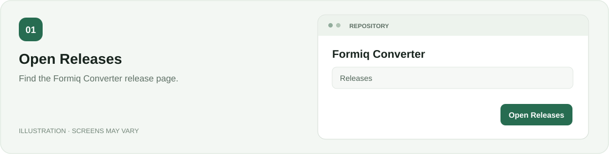

### 2. Download the Windows setup

Under **Assets**, select **Formiq-Converter-Setup-1.0.0.exe** and wait for the download to finish. The file ending in `Preview.exe` is an older build.

GitHub also displays automatically generated “Source code” archives. These contain this public guide, images and notices; Formiq's application source is maintained separately and is not included in this repository.

### 3. Open the downloaded file

Open your **Downloads** folder and double-click the Formiq setup file. Only run a file from a source you trust.

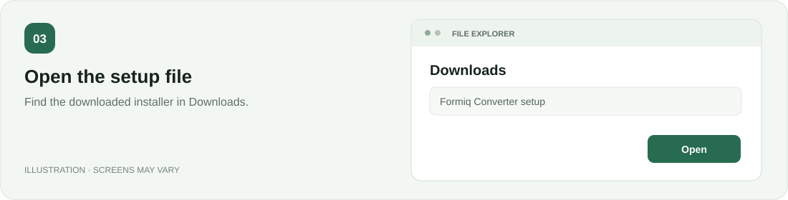

### 4. Review Windows administrator approval

Windows may ask for permission to make changes. Check the source and publisher before deciding whether to continue. The current preview is unsigned, so Windows may show an unknown publisher or block the file. The shield alone does not verify the publisher.

### 5. Read the setup information

Read the information and draft terms shown by the setup wizard. Accept the terms to continue if you agree.

### 6. Choose an installation folder

Use the suggested location or choose another folder, then select **Next**. The default is normally under `Program Files`.

### 7. Choose shortcut options

Choose whether you want the optional desktop shortcut, then select **Next**. A Start menu shortcut is created by the installer.

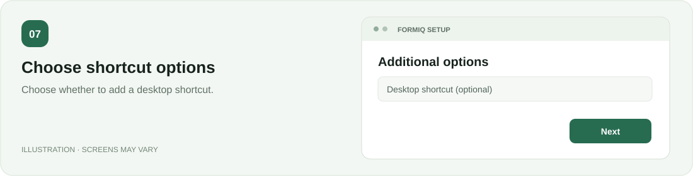

### 8. Review and install

Check your choices and select **Install**. Wait while the installer copies the application files.

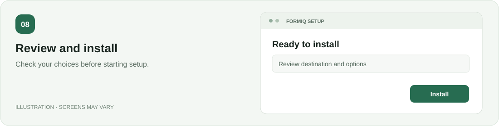

### 9. Finish and open Formiq

Select **Finish**. Open **Formiq Converter** from the Start menu or the desktop shortcut if you chose one.

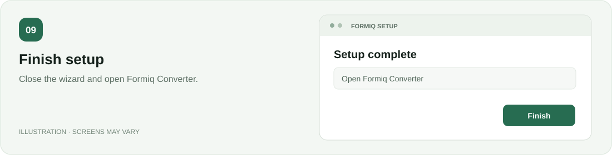

> The actual administrator installation and its screens still need verification on a clean Windows PC before release.

## Using Formiq

1. Choose a conversion tool from the home screen.
2. Select **Add files** or drop supported files into the window. Select a file to preview it.
3. For WebP, adjust the dimensions, quality and fit if needed. For multiple images to PDF, choose separate files or one combined PDF when prompted.
4. Under **Save in**, choose a destination. Output files are saved directly in that folder.
5. Select **Convert files**. If a name already exists, choose **Replace**, **Skip**, or **Cancel conversion**. The output folder opens after files are saved.

Formiq refuses to replace a selected source file. JPG does not support transparency; transparent areas are flattened to white. PDF-to-image conversion exports each page as a separate image.

## Uninstall

These instructions describe the intended Windows removal flow. The following visuals are **illustrations**, not screenshots, and the actual administrator uninstall still needs a clean-machine test.

### 1. Close Formiq Converter

Close the application and wait for any conversion to finish or cancel.

### 2. Open Windows app settings

Open **Settings → Apps → Installed apps**. On Windows 10, this page may be called **Apps & features**.

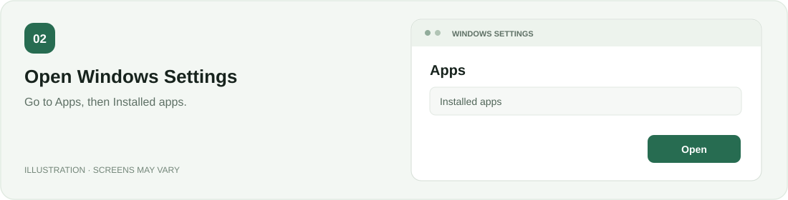

### 3. Find Formiq Converter

Search for **Formiq Converter** in the installed apps list.

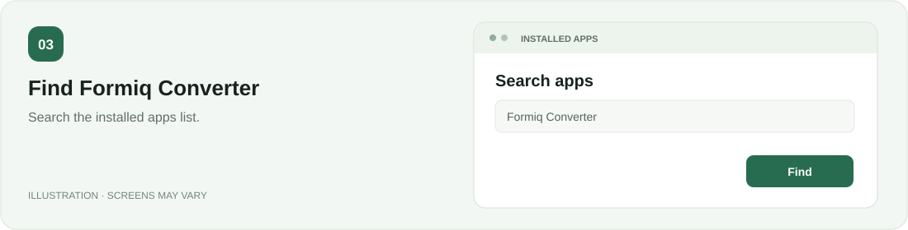

### 4. Select Uninstall

Open the menu beside Formiq Converter and choose **Uninstall**.

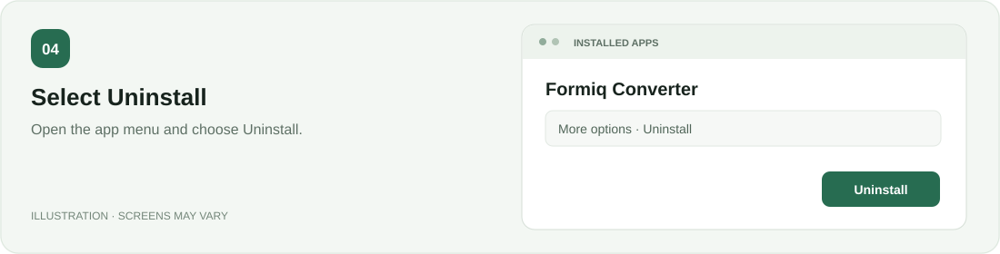

### 5. Follow the prompts

Review the Windows and uninstaller prompts and confirm if you want to remove the application. Wait until the uninstaller finishes.

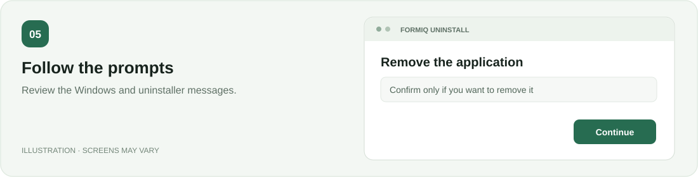

### 6. Check your converted files

Look in the output folders you selected while using Formiq. Uninstalling the app is not intended to remove your converted files. An isolated test preserved a user-created file, but the final uninstall still needs verification.

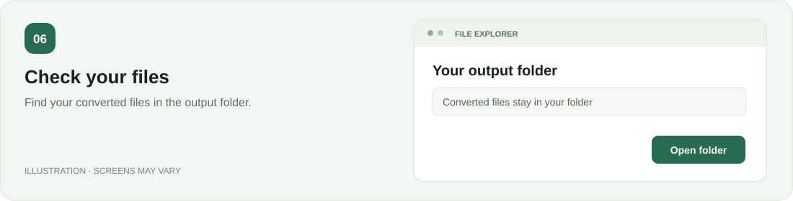

## Conversion tools

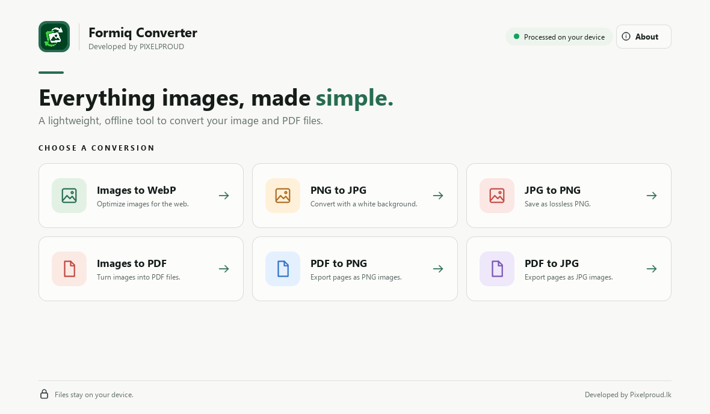

| Tool | What it does |
| --- | --- |
| **Images to WebP** | Convert PNG or JPG images to WebP, with size and quality controls. |
| **PNG to JPG** | Save PNG images as JPG. Transparent areas are placed on white. |
| **JPG to PNG** | Convert JPG or JPEG images to PNG. |
| **Images to PDF** | Create separate PDFs or combine multiple images into one PDF in the order shown. |
| **PDF to PNG** | Export PDF pages as PNG images. |
| **PDF to JPG** | Export PDF pages as JPG images. |

### Images to WebP

Add PNG or JPG files, then choose the dimensions, quality and fit. Select **Convert files** to save WebP images in your output folder.

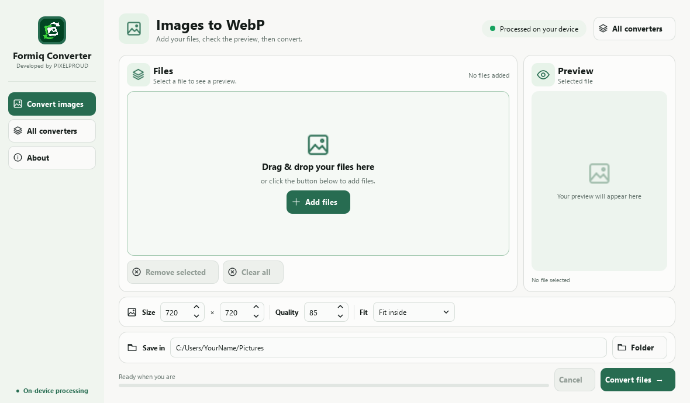

### PNG to JPG

Add PNG files and convert them to JPG. Because JPG does not support transparency, transparent areas are placed on a white background.

### JPG to PNG

Add JPG or JPEG files and save them as PNG. PNG preserves the image without adding further JPEG compression.

### Images to PDF

Add PNG or JPG files. If you select multiple images, choose whether to create separate PDFs or combine them into one PDF, in the order shown.

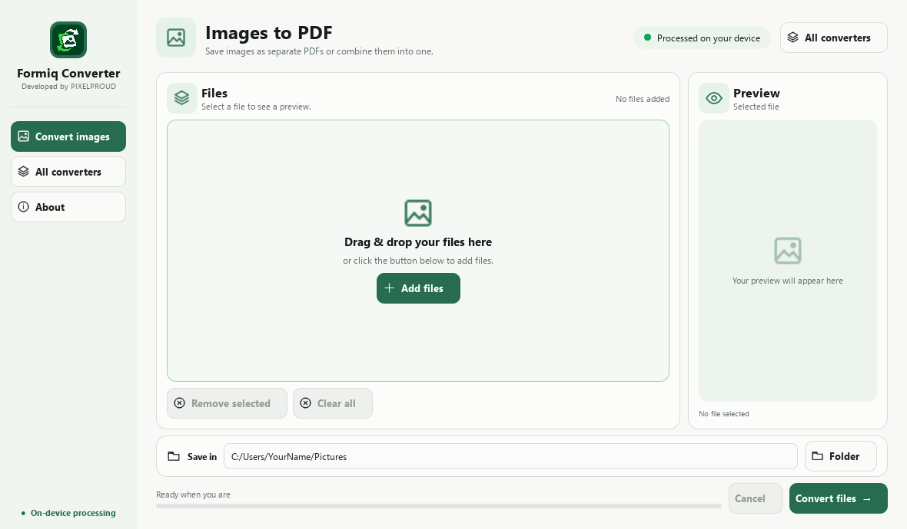

### PDF to PNG

Add a PDF and convert its pages into separate PNG images. Select a file in the list to preview its first page.

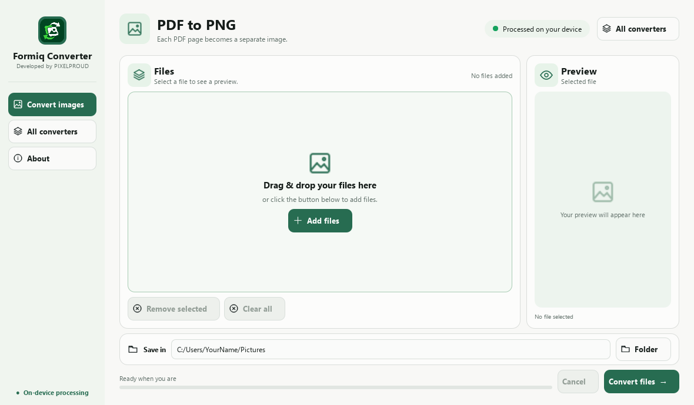

### PDF to JPG

Add a PDF and convert its pages into separate JPG images. Choose the output folder before starting the conversion.

## Privacy and safety

- Image and PDF conversion is designed to run locally on your computer.
- Keep backups of important files and review the output before deleting originals.
- Download installers only from a release you trust. The present preview is unsigned and Windows may warn or block it.
- The installer requests administrator permission; the application is intended to run as a normal user.
- No application can be guaranteed free of defects. Release testing and a dependency license review are still outstanding.

## Versions

| Version | Status | Notes |
| --- | --- | --- |
| **1.0.0** | Preview available | Initial Windows release: image and PDF converters, previews, direct-to-folder saving and overwrite prompts. |

Future releases should be published on the same repository's **Releases** page, with version-specific notes and the matching Windows installer attached to each release.

## Developer and support

Developed by **PIXELPROUD**. Founder: **Mohamed Yaseer**.

- Email: [info@pixelproud.lk](mailto:info@pixelproud.lk)
- Founder: [yaseer.inbox@hotmail.com](mailto:yaseer.inbox@hotmail.com)
- Website: [yaseerm.me](https://yaseerm.me)

## Licensing and notices

Formiq Converter is developed by PIXELPROUD; its application code is not published in this repository. The application includes third-party components, each subject to its own licenses. See [third-party notices](notices/README.md), the [LGPL v3](notices/LGPL-3.0.txt), [GPL v3](notices/GPL-3.0.txt) and [original converter MIT notice](notices/original-converter-MIT.txt).
